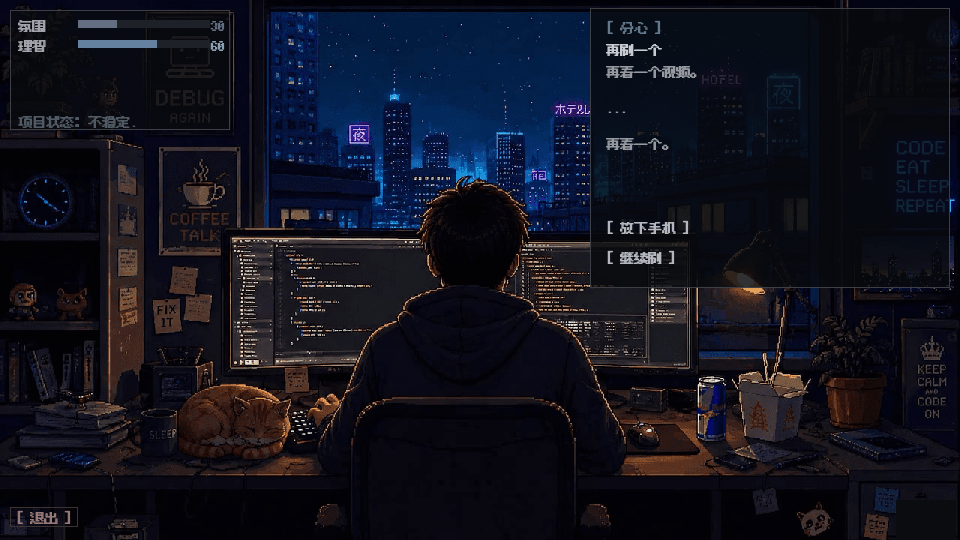

# 深夜程序员模拟器 · Late Night Programmer Simulator

一款陪你等待 AI 干完活的像素风桌面小游戏。深夜、代码、咖啡、一只猫和偶尔下起的雨；可以安静观看，也可以选择事件选项，影响氛围、理智和项目进度。

**实验性作品 · Early prototype · v0.1.0-preview**

这是一个个人学习与 AI 辅助开发实验，仍不成熟，可能有 Bug、动画衔接或性能问题。欢迎试玩和反馈；请把它当作早期原型，而非完成度很高的正式产品。

**[下载 Windows EXE 试玩](https://github.com/AethelActin/late-night-programmer-simulator/releases/download/v0.1.0-preview/LateNightProgrammerSimulator.exe)** · [版本说明与附件](https://github.com/AethelActin/late-night-programmer-simulator/releases/tag/v0.1.0-preview) · [反馈问题](https://github.com/AethelActin/late-night-programmer-simulator/issues)

美术动画由作者使用 Google 视频生成工具生成短片后剪辑、抽帧和接入。当前公开试玩版不附带原项目的第三方背景音乐，使用 OFL 授权的 Press Start 2P 和 Fusion Pixel 字体，并附许可文本。代码和素材范围见 [RIGHTS.md](RIGHTS.md)。

仓库包含源码、事件数据、文档、截图和第三方许可；原始动画和字体没有放进源码仓库。**普通玩家请下载 Releases 中的 EXE**，无需配置 Python 或素材。只下载 Source code ZIP 的开发者需先按[素材说明](docs/ASSET_SETUP.md)配置资源。



## 直接运行

- 从上方链接下载 `LateNightProgrammerSimulator.exe`，Windows 下双击运行，不需要另装 Python。
- 首次启动需要解压内置素材，可能需要等待；该实验版尚未签名，其他系统和最低配置未验证。
- 菜单可切换中英文、音乐开关。选择时长后进入游戏；事件选项可点击，不操作约 8 秒后中性关闭。
- `Esc` 或左下角退出按钮打开返回菜单确认框，确认期间局内暂停。理智耗尽或进度达到 100% 后仍可返回菜单重开。
- 没有存档、账号、联网、广告或真实 AI 调用；退出程序后不保留进度。
- 公开版没有背景配乐；音乐控制在没有音频资源时不可用。

## 源码运行

本机验证环境：Windows 11 x64、Python 3.13.0、pygame 2.6.1。其他系统和最低配置尚未验证。

```powershell
python -m venv .venv
.\.venv\Scripts\python.exe -m pip install -r requirements.txt
.\.venv\Scripts\python.exe tools/check_assets.py
.\.venv\Scripts\python.exe main.py
```

## 检查和打包

```powershell
# 标准库 unittest，不需要另装 pytest
python -B -m unittest discover -s tests -v

# 规则抽样：三个时长各 20 个固定种子，不能代替真实玩家数据
python -B tools/simulate_sessions.py --seeds 20

# 使用 spec，另建候选目录，保留原 EXE
python -m pip install -r requirements-build.txt
python -m PyInstaller --noconfirm --distpath dist/public --workpath build/public LateNightProgrammerSimulator-public.spec

# 离屏打包冒烟：读取包内真实资源，走菜单、两种结局和重开后退出
$env:SDL_VIDEODRIVER = 'dummy'
$env:SDL_AUDIODRIVER = 'dummy'
& .\dist\public\LateNightProgrammerSimulator.exe --smoke-test
Remove-Item Env:SDL_VIDEODRIVER, Env:SDL_AUDIODRIVER
```

源码依赖按清单装入项目虚拟环境即可；不要把个人全局 Python 路径写进项目。单文件 EXE 会先解压到系统临时目录，包体和冷启动仍需进一步优化。

## 主要文件

| 路径 | 职责 |
| --- | --- |
| `main.py` | 窗口、菜单、输入、模态暂停和缩放 |
| `src/session.py` | 一局生命周期、数值增长、事件与动画联动、结局 |
| `src/event_system.py` | 游戏时间调度、条件过滤、一次性选项结算、日志 |
| `src/state_manager.py` | 动画域、猫动画链、转场 |
| `src/sprite_engine.py` | PNG 播放、帧缓存、淡入转场 |
| `src/audio_manager.py` | 按需加载音乐、静音、交叉淡入、无设备降级 |
| `src/ui.py` / `src/lang.py` | 布局和双语文本 |
| `data/` / `assets/` | 事件配置与原始素材 |
| `tests/` | 生命周期、动画、音频和真实资源离屏回归 |

事件文件使用带整行 `//` 注释的 JSON，通过事件加载器读取。数据中 `audio`、`visual` 扩展字段目前没有对应特效实现。新增动画应遵循 [SPRITE_RULES.md](SPRITE_RULES.md)。

## 技术与实现

- 通过一局控制器统一数值、事件、动画和结局，集中处理暂停、重开与场景切换。
- 主事件与环境日志分别调度；支持按场景和数值筛选、一次性选择结算。
- PNG 按当前帧解码，采用 96 帧 LRU 缓存；音频按需加载。
- 固定逻辑画布等比缩放，鼠标映射回逻辑坐标；支持中英文切换。
- 本地完整资源环境下 28 项回归通过；源码展示副本缺少素材时跳过 4 项图形检查，不能把 skipped 计作通过。

本项目经历过 AI 辅助生成、人工素材剪辑与集成、运行缺陷修复和自动检查。当前是个人实验性作品，尚无真实玩家留存或广告收入记录。
